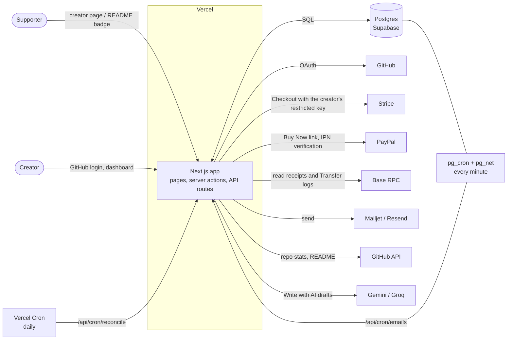

# Architecture

buymeatokens is a single Next.js app backed by one Postgres database. It has no separate backend and no queue.
Payment providers talk to the creator's account directly; we only create checkouts and confirm what happened.



## Principles

- **We never hold supporters' money.** Each payment rail pays the creator's own account. That keeps the platform
  out of fund custody, and it's why pooled payments are only a research item on the [roadmap](../ROADMAP.md).
- **Confirm, don't trust.** A payment counts only after we confirm it with the provider: Stripe sessions are
  re-read, PayPal IPNs are posted back for validation and USDC transfers are read from the chain.
- **Idempotent everything.** Duplicate webhooks, double clicks, retries and concurrent cold starts must not
  double-count support or send an email twice. Unique constraints and atomic claims do that work.
- **Flags over branches.** Risky behavior ships off and is turned on with an environment flag:
  `EMAIL_LIVE_ENABLED`, `GATED_SIGNUPS`, `EARLY_ACCESS_OPEN`.

## Code layout

```
src/
  app/
    page.tsx                 home page
    [username]/              public creator page, checkout action, thank-you page, link preview card
    onboarding/              guided setup, one step per route
    dashboard/               creator dashboard: overview, analytics, settings, payments, account
    admin/                   registrations and email previews (ADMIN_GITHUB_LOGINS only)
    apply/, r/[code]/        gated signups and referral links
    leaderboard/             most-supported projects: all time, plus daily/weekly/monthly (opt-in)
    blog/, about/, roadmap/  marketing pages; posts live in content/blog/*.md
    directory/               project directory: static listing (5 min) and dynamic, noindex search at directory/search
    terms/, privacy/, faq/   legal pages; the texts live in content/legal/en/*.md
    llms.txt/, sitemap.ts    search engine and AI assistant entry points
    draft-actions.ts         "Write with AI" for the project description (README, or saved project details without a repo)
    api/
      auth/                  GitHub OAuth and the development login
      alerts/[token]/        stream alerts feed (JSON), read with the creator's secret token
      badge/[username]/      README badge (SVG)
      wall/[username]/       README supporter wall (SVG)
      creators/[username]/   the signed-in creator's payment history (CSV); page visit counting (visit/)
      paypal/ipn/            PayPal payment notifications (validated with PayPal)
      cron/reconcile/        daily check of pending Stripe sessions
      cron/emails/           minute worker for creator emails
  components/                shared React components
  lib/                       domain logic, with no React; see below
public/widget.js             the website button creators embed on their sites (plain script, no dependencies)
content/blog/                blog posts (Markdown + frontmatter)
content/legal/               Terms of Service and Privacy Policy
scripts/                     operator scripts (run with `npx tsx`; dry runs unless given --apply)
tests/                       Vitest suites, running on in-memory PGlite
```

Key modules in `src/lib`:

| Module | Responsibility |
|---|---|
| `db.ts` | Connection, the schema and its automatic application ([database.md](database.md)) |
| `session.ts` | Signed session cookie. The OAuth flow itself is in `src/app/api/auth/github/` |
| `github.ts`, `contributors.ts` | GitHub API: repo stats, the README brief for AI drafts, the Contributor badge |
| `crypto.ts` | AES-256-GCM encryption of creators' Stripe keys with `ENCRYPTION_KEY`, HMAC signing |
| `redact.ts` | `logError`, which blanks out anything shaped like a key before it reaches the logs |
| `stripe.ts`, `paypal.ts`, `usdc.ts` | The three payment rails ([payments.md](payments.md)) |
| `donations.ts`, `reconcile.ts` | Recording support and confirming pending payments |
| `access.ts`, `billing.ts`, `access-copy.ts` | Signup gate and admins; the creator's plan (lifetime free or early access) and its wording |
| `users.ts` | Accounts; claiming a username, which also grants lifetime free access |
| `creator-emails.ts`, `email.ts`, `email-layout.ts` | Email flow, providers and templates ([emails.md](emails.md)) |
| `creator-card.ts` | Text for the creator link preview card (`[username]/opengraph-image.tsx`) |
| `badge.ts`, `badge-font.ts`, `wall.ts` | Badge and supporter wall rendering. The glyph outlines are generated by `scripts/build-badge-font.mjs` |
| `setup.ts`, `profile.ts`, `socials.ts`, `validation.ts` | Guided setup, profile fields, reserved usernames |
| `directory.ts` | Opt-in project directory: fixed category and language lists, word-prefix full-text search on a partial GIN index, 24 per page up to page 20 |
| `leaderboard.ts` | The leaderboard query: opted-in (`users.leaderboard_opt_in`), listable (`LISTABLE_SQL` in `seo.ts`), live-mode creators ranked by tokens of confirmed live support over rolling 24h / 7d / 30d / all-time windows, top 50, one grouped query per period served by `donations_paid_at`. Pages revalidate every 5 minutes. It shows only what the creator's page already shows (name, avatar, tokens, supporter count), never dollars. It ranks recorded support, not verified popularity: payers are not verified, so self-support can't be prevented |
| `seo.ts`, `blog.ts` | Structured data, sitemap inputs and blog loading |
| `legal/`, `consent.ts` | Legal values and copy, Terms acceptance and its version ([legal.md](legal.md)) |
| `account-deletion.ts`, `payment-export.ts` | Self-service account deletion and the payment history CSV |
| `stream-alerts.ts` | Stream alert token (stored as a hash), the feed query and its cursor, the widget's URL options ([stream-alerts.md](stream-alerts.md)) |
| `ai-draft.ts` | Prompts, provider chain and daily caps for "Write with AI" |
| `page-visits.ts`, `visit-source.ts`, `visit-client.ts` | Page analytics without cookies: counting visits and support starts with a daily salted mark, where visits come from, and the Analytics tab's numbers |

## Access and pricing rules

These rules are part of a public promise, so changes to them need an [ADR](adr/):

- While `EARLY_ACCESS_OPEN=true` (the default), claiming a username grants **lifetime free access**
  (`users.lifetime_free_granted_at`). Nothing later removes it.
- There are no subscriptions today, so every creator is free and the support button is never paused. The planned
  pricing for accounts without lifetime access ($1/month or $9/year after $5 of support) is only a plan, shown on
  `/about`. Building it would need a payment provider for subscriptions and an ADR. A first version with Paddle
  existed until v0.1.0; see that tag if you need it.

## Deployment

- Production runs on Vercel and the database on Supabase. Maintainers deploy manually from `main`, and pushing
  does not deploy anything. See [maintainers/releasing.md](maintainers/releasing.md).
- Vercel Cron calls `/api/cron/reconcile` daily, authenticated with `CRON_SECRET`.
- Supabase `pg_cron` + `pg_net` call `/api/cron/emails` every minute with `EMAIL_CRON_SECRET`. That secret lives in
  Supabase Vault, not in the cron command.
