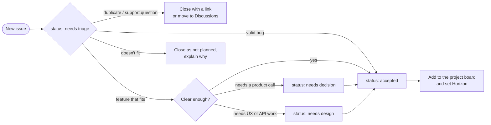

# Triage

Triage turns incoming issues into a clean, prioritized backlog. The aim is a first response on every new issue
within a week.

## The flow

1. Issue forms add `status: needs triage` automatically.
2. Reproduce bugs, or ask for the missing details. If there's no reply in 14 days, close it; it can always be reopened.
3. Add one `type:` label and at least one `area:` label.
4. Decide: `status: accepted`, `status: needs decision`, `status: needs design`, or close it.
5. Add accepted work to the [project board](https://github.com/users/Renanuya/projects/7) with a
   **Horizon** (Now / Next / Later) and, for launch work, a milestone.
6. Small, well-described, low-risk issues also get `good first issue`. Bigger ones we'd welcome help on get `help wanted`.

## Labels

The labels are defined in [`.github/labels.json`](../../.github/labels.json) and synced by a workflow. Change them there.

| Group | Labels | Meaning |
|---|---|---|
| Type | `type: bug`, `type: feature`, `type: docs`, `type: chore`, `type: security` | What kind of work it is. Exactly one per issue. |
| Area | `area: payments`, `area: billing`, `area: auth`, `area: database`, `area: emails`, `area: creator-pages`, `area: badges`, `area: site`, `area: api`, `area: infra` | Which part of the product it touches. |
| Status | `status: needs triage`, `status: accepted`, `status: needs decision`, `status: needs design`, `status: blocked` | Where it is in the flow. |
| Community | `good first issue`, `help wanted` | Invitations to contributors. GitHub surfaces these. |

## What makes a good first issue

- It touches one or two files and needs no production access, payments account or product decision.
- It says exactly where to look and what "done" means.
- There's a maintainer ready to answer questions about it within a few days.

## Ideas from Discussions

Check [Discussions → Ideas](https://github.com/Renanuya/buymeatokens-oss/discussions/categories/ideas) monthly, sorted
by votes. When an idea fits and is clear enough, open an issue for it, link the discussion, and reply there with the
outcome. If it doesn't fit, say so and why. Ideas shouldn't sit unanswered.

## Stale work

There's no stale bot. Once a month, review issues that have been `status: blocked` or assigned with no activity for
over 30 days, and unassign or close them with a short note.
