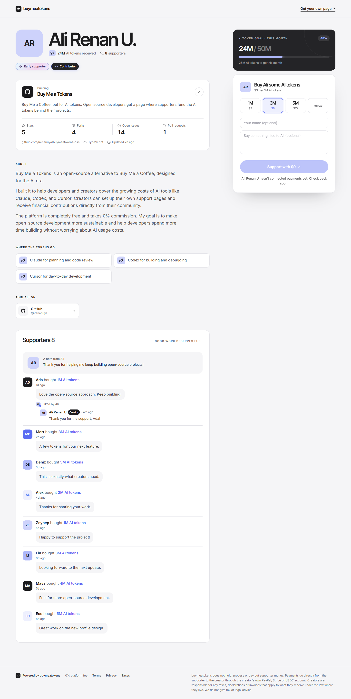
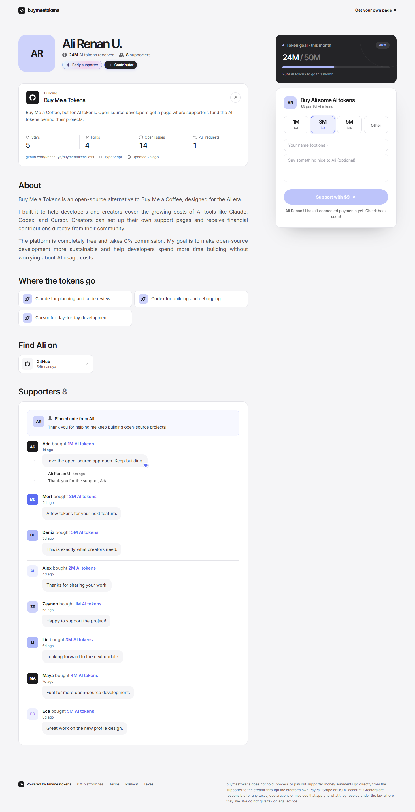
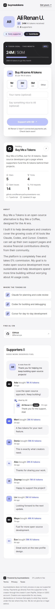
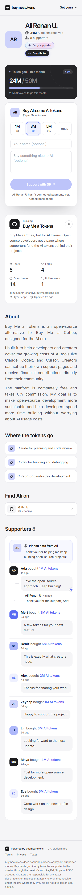

# Creator profile UI comparison

Both versions show the same local `demo` profile with eight synthetic supporters. Payments are disabled.
The baseline is `main` at `32c4220`; the after images show the changes in this pull request.
Desktop screenshots use a 1440px viewport; mobile screenshots use 390px.

The update aligns profile badges beneath the statistics, uses matching filled icons, makes section headings
readable and justifies the full-width bio. The supporters heading sits above its card; the creator note is pinned,
replies use a minimal connected layout, and likes appear as compact heart reactions with an accessible label.

## Desktop

| Before | After |
| --- | --- |
|  |  |

## Mobile

| Before | After |
| --- | --- |
|  |  |

## Validation

- Typography policy, typecheck, production build and the full test suite.
- Browser checks at 1440px, 1024px, 390px and 320px: icon spacing, section alignment and horizontal overflow.
- Local creator login: reply creation, editing, cancellation, persistence, deletion and like toggling.
- Thread connectors appear and disappear with replies; heart reactions retain the creator's name in their
  accessible label and native tooltip.
